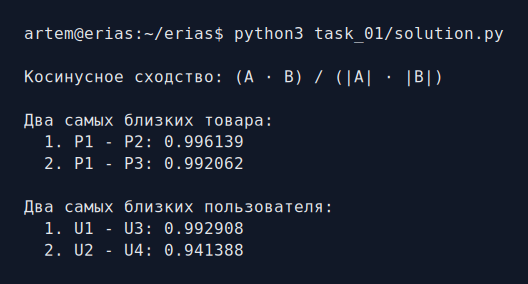
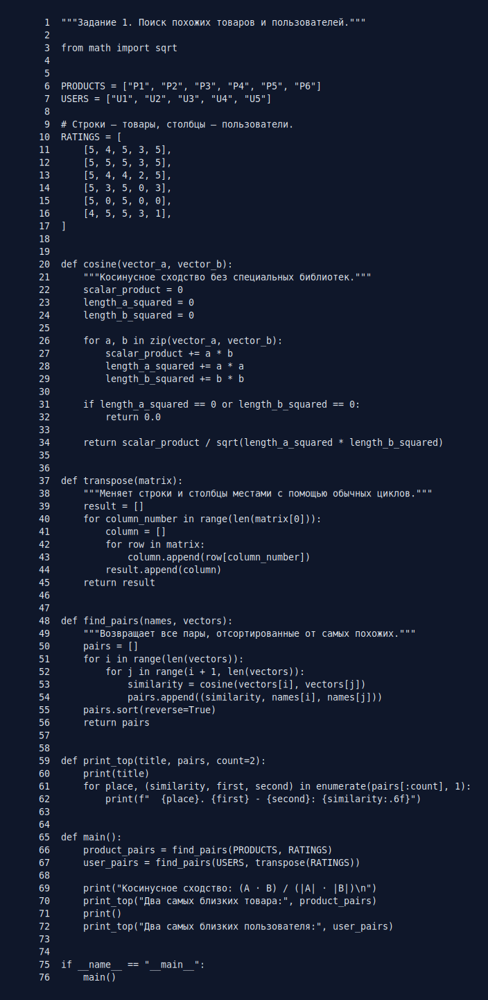

# Задание 1. Косинусное сходство

Нужно найти две наиболее близкие пары товаров и две наиболее близкие пары
пользователей в матрице предпочтений.

## Метод

Товар представлен строкой оценок, а пользователь — столбцом. Для каждой пары
векторов считается косинусное сходство:

```text
cos(A, B) = (A1*B1 + ... + An*Bn) /
            (sqrt(A1^2 + ... + An^2) * sqrt(B1^2 + ... + Bn^2))
```

Чем результат ближе к 1, тем объекты похожее. В
[solution.py](solution.py) скалярное произведение, длины векторов, транспонирование
матрицы и перебор пар написаны обычными циклами. Из библиотек используется только
`sqrt` из стандартного модуля `math`.

## Запуск

```bash
python3 task_01/solution.py
```

## Результат работы



## Исходный код

Полный редактируемый файл: [solution.py](solution.py).


