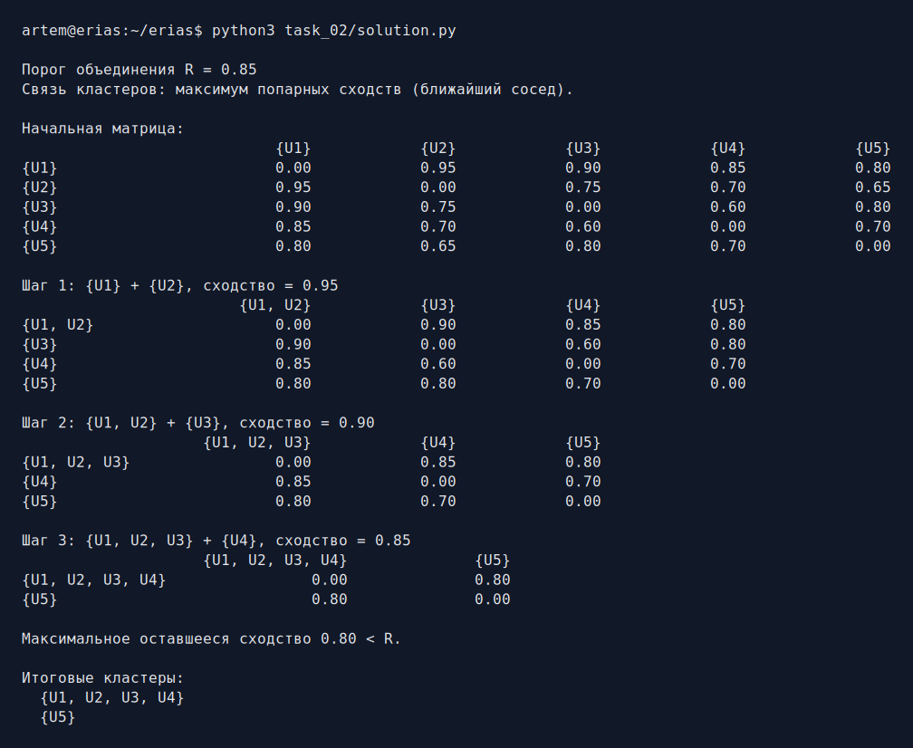
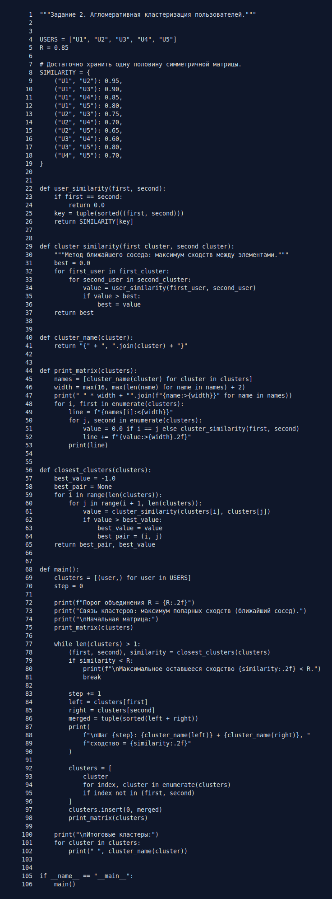

# Задание 2. Агломеративная кластеризация

По готовой матрице косинусного сходства нужно объединить пользователей в
кластеры при пороге `R = 0.85`.

## Метод

На каждом шаге программа:

1. перебирает все пары текущих кластеров;
2. находит пару с максимальным сходством;
3. объединяет её, если сходство не меньше `R`;
4. перестраивает и печатает матрицу.

Сходство двух кластеров определяется методом ближайшего соседа — как максимум
сходств между всеми парами их пользователей. Именно так перестроены матрицы в
исходном файле: например, сходство `{U1, U2}` и `U3` равно
`max(0.90, 0.75) = 0.90`. Равенство порогу тоже разрешает объединение.

Все операции с матрицей и кластерами реализованы обычными списками, словарём и
циклами в [solution.py](solution.py).

## Запуск

```bash
python3 task_02/solution.py
```

## Результат работы



Получены два кластера: `{U1, U2, U3, U4}` и `{U5}`.

## Исходный код


