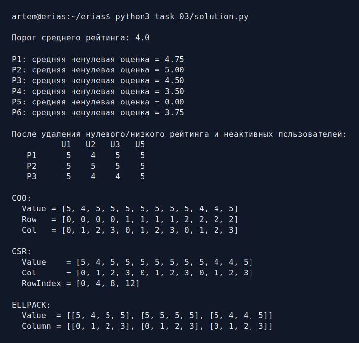
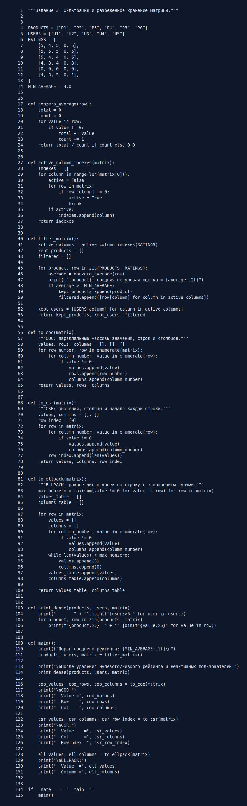

# Задание 3. Разреженные матрицы

Нужно очистить матрицу предпочтений и представить её в форматах разреженного
хранения без применения `numpy` и `scipy`.

## Фильтрация

- нулевая оценка означает отсутствие оценки и не участвует в среднем;
- товар удаляется, если у него нет оценок или средняя ненулевая оценка меньше 4;
- пользователь удаляется, если все его оценки равны нулю.

После фильтрации остаются товары `P1`, `P2`, `P3` и пользователи `U1`, `U2`,
`U3`, `U5`. Для `P1` программа получает `(5 + 4 + 5 + 5) / 4 = 4.75`.
В исходной книге рядом с этой строкой написано 4.5, но это не совпадает с
арифметикой исходных оценок.

## Форматы хранения

- **COO** хранит три массива: значения, номера строк и номера столбцов.
- **CSR** хранит значения, номера столбцов и позиции начала строк.
- **ELLPACK** отводит каждой строке одинаковое число мест, дополняя короткие
  строки нулями.

Преобразования реализованы вручную в [solution.py](solution.py).

## Запуск

```bash
python3 task_03/solution.py
```

## Результат работы



## Исходный код


