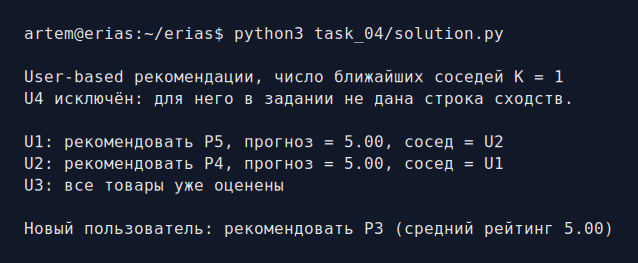
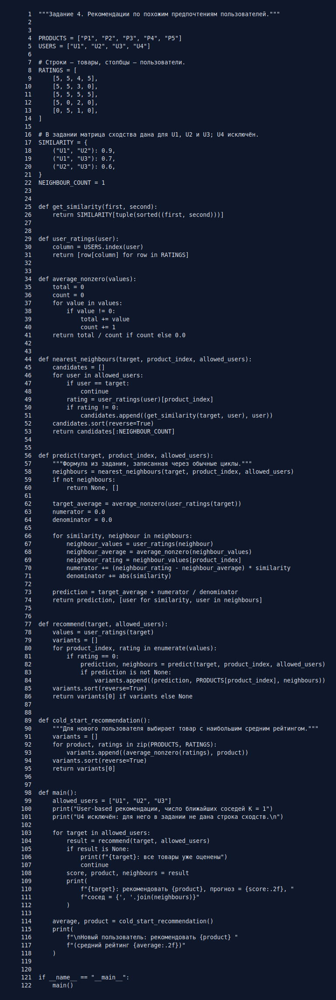

# Задание 4. User-based рекомендации

Нужно рекомендовать неоценённый товар на основе предпочтений похожего
пользователя. Ноль в таблице означает, что оценки нет.

## Метод

Для пользователя `a` и товара `i` используется формула из задания:

```text
Pr(a, i) = mean(a) +
           sum((rating(u, i) - mean(u)) * cos(a, u)) /
           sum(abs(cos(a, u)))
```

В примере берётся `K = 1`, то есть один ближайший пользователь, который уже
оценил нужный товар. Средние вычисляются только по ненулевым оценкам. Матрица
сходства для `U1`, `U2`, `U3` дана в исходном файле, а `U4` там явно исключён,
поэтому программа не придумывает отсутствующие коэффициенты.

Итог совпадает с примером в книге:

- `U1` получает рекомендацию `P5` от ближайшего `U2`;
- `U2` получает рекомендацию `P4` от ближайшего `U1`;
- `U3` уже оценил все товары.

Для нового пользователя без оценок выбирается товар с наибольшей средней
ненулевой оценкой — `P3`.

Расчёт написан обычными циклами в [solution.py](solution.py), сторонние
библиотеки не используются.

## Запуск

```bash
python3 task_04/solution.py
```

## Результат работы



## Исходный код


